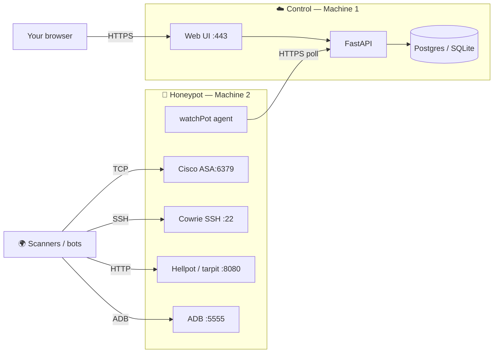

# Watch Pot: 7 Day Demo Writeup

## Summary

Using Watch Pot I exercised a 7 day honeypot test to test the full suite of features and attempt to test and examine any findings. The strongest behavior in the supplied log excerpts was an ADB via TCP session on port 5555 that issued a shell command attempting to download and launch an Android second stage script. The command tried multiple writable paths and download clients, attempted a second detached run, and returned a nonce plus CPU architecture. This is consistent with Android botnet-loader tradecraft sometimes associated with Mirai-like campaigns, but the excerpt does not establish Mirai attribution or successful execution on a real device.

The excerpts also show SSH credential validation, attempted SSH tunnel/proxy use, and post-login hardware fingerprinting.

- Commands Logged: over 2000 unique commands
- IPs Hit: 899 - 127 were labeled as suspicious
- CVE Fingerprints:  12 top 3 being CVE-2022-40684 - CVE-2023-27997 - CVE-2024-3400
- Events Per Hour: 397.62/hr

## Demo scope and topology

The test writeup describes two machines:

- **Control machine:** Web UI on HTTPS (443), FastAPI, and Postgres/SQLite.
- **Honeypot machine:** Watch Pot agent plus exposed emulations for Cisco ASA (6379), Cowrie SSH (22), Hellpot/tarpit (8080), and ADB (5555). The agent polls the API over HTTPS; scanners reach the emulated services.

## Main finding: ADB Android dropper behavior

The ADBHoney log records a connection from `108.165.95.17` to destination port 5555. The command attempts to:

1. Change to the first writable directory among `/data/local/tmp`, `/sdcard`, `/tmp`, and `/`.
2. Fetch a script from a defanged host (`hxxp://wemqmewkqewq[.]work[.]gd/kla.sh`) using `wget`, `curl`, `toybox wget`, or `busybox wget`.
3. Run the downloaded file as `sh k android` after checking it is non-empty and setting broad execute permissions.
4. Repeat the fetch-and-run inside a detached `setsid` process, suppressing output.
5. Print a nonce and `uname -m`, likely to signal command completion and identify the device architecture.

## Other observed behaviors

### SSH credential validation and host discovery

A Go SSH client connected from `152.32.254.222`; the emulated service accepted `minecraft/123456`. The client ran `uname -s -v -n -r -m` and then ended the session. This looks like a credential check followed by basic system fingerprinting. The client banner and handshake fingerprint help characterize tooling, but do not identify an operator by themselves.

### SSH tunnel/proxy attempt

A PuTTY-banner client from `63.141.242.2` authenticated to the emulated service with `root/password`, then requested SSH `direct-tcpip` forwarding. One request targeted `159.65.2.87:80` and carried an HTTP POST whose Host header was `api.9hits.com`. Cowrie discarded the forwarding request and logged a connection refusal. This indicates attempted use of the SSH account as a relay.

### Hardware fingerprinting

A session from `2.57.122.209` ran commands probing CPU count/model, architecture, device-tree model, and graphics hardware (`nproc`, `lscpu`, `/proc/cpuinfo`, `lspci`, and related filters). This is consistent with host profiling before choosing a payload or deciding whether a host is valuable. Intent cannot be established from these commands alone.

## Takeaways and follow-up

- Exposed ADB can turn a network-reachable service into an unauthenticated command surface on misconfigured Android/IoT devices.
- Weak credential pairs can be used for SSH access, followed by reconnaissance or attempts to relay traffic through the host.
- Honeypot evidence supports behavioral characterization, but attribution and real-world impact require corroboration.
